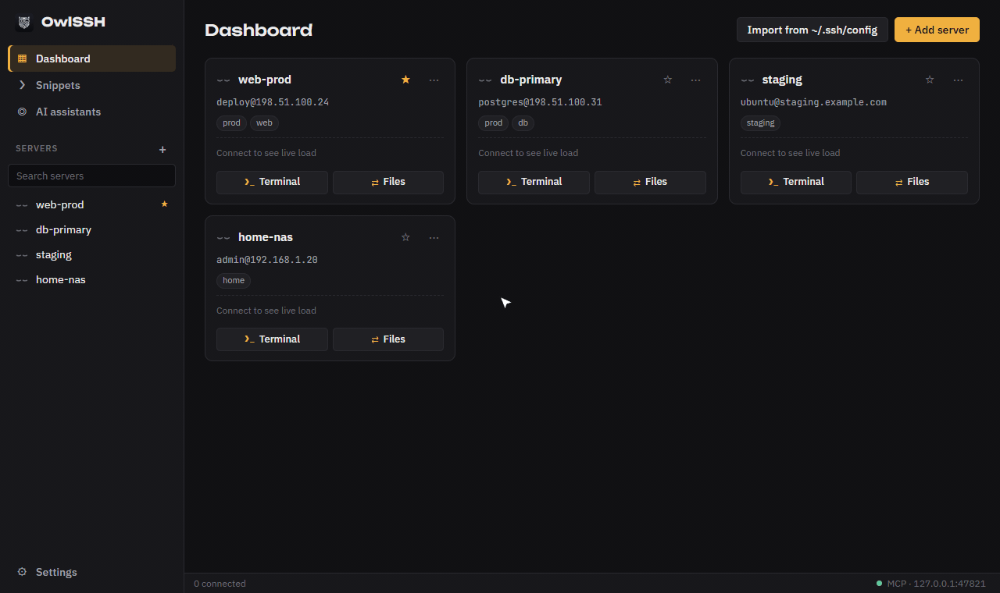
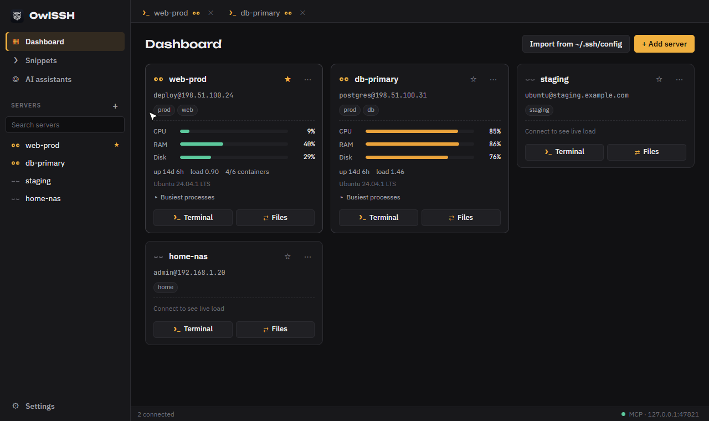
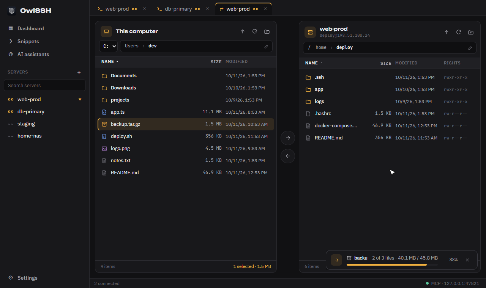
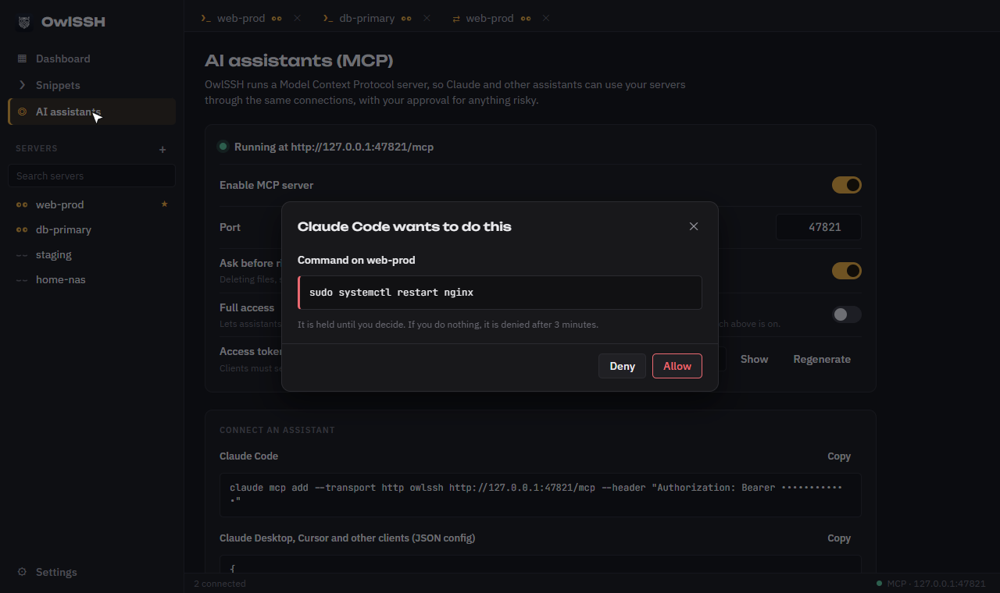

<div align="center">

<picture>
  <source media="(prefers-color-scheme: dark)" srcset="assets/logo-light.png">
  
</picture>

# OwlSSH

**A fast desktop SSH client with a live server dashboard, a two-pane file manager and a built-in MCP server, so your AI assistant can work on the same servers you do.**

[](https://github.com/Deskezz-exe/OwlSSH-with-mcp/releases/latest)
[](https://github.com/Deskezz-exe/OwlSSH-with-mcp/actions/workflows/ci.yml)
[](LICENSE)


[Download](#download) · [Features](#features) · [AI assistants](#ai-assistants-mcp) · [Development](#development)

<br>



</div>

## Why

- **The terminal keeps up with your typing.** `TCP_NODELAY` on the socket, keystrokes sent
  without blocking the UI, output streamed as raw bytes.
- **You see every server at a glance.** CPU, RAM, disk, load, top processes and Docker
  containers on each card, with nothing to install on the server.
- **Your AI assistant uses the connections you already have.** Claude Code, Cursor and other
  MCP clients run commands and move files through OwlSSH, and anything risky waits for your click.

## Download

Get the latest build from [Releases](https://github.com/Deskezz-exe/OwlSSH-with-mcp/releases/latest):

| System | File |
|---|---|
| Windows 10/11 | `*_x64-setup.exe` installer, or `*_x64_portable.exe` that runs without installing |
| macOS (Apple Silicon and Intel) | `*_universal.dmg` |
| Linux | `*.AppImage`, `*.deb` or `*.rpm` |

Every release has a `SHA256SUMS.txt` to check the files. The builds are not signed with a
paid certificate yet, so Windows SmartScreen may ask you to click **More info** → **Run anyway**,
and on macOS the first launch is right click → **Open**.

## Screenshots

| Dashboard | Files | AI approval |
|---|---|---|
| [](docs/media/dashboard.png) | [](docs/media/files.png) | [](docs/media/approval.png) |

## Features

**Terminal**
- Tabs with real PTY sessions, xterm.js with the WebGL renderer
- Copy and paste shortcuts you can change in settings (`Ctrl+Shift+C` / `Ctrl+Shift+V`
  by default). They match the physical key, so they work on any keyboard layout
- Copy on select, right click to paste or open a menu, bracketed paste
- Font size, scrollback and cursor settings

**Dashboard**
- A card per server with live CPU, RAM and disk bars, uptime, load, OS,
  busiest processes and Docker containers
- One POSIX probe per refresh over the existing connection
- Favorites, tags and search
- Import hosts from `~/.ssh/config`, jump hosts (ProxyJump)

**Files**
- Two panes: this computer and the server
- Drag files between panes, or straight from Explorer / Finder onto the server
- Folders transfer recursively, with progress and cancel
- When a name already exists you choose: replace it, save under a new name or cancel
- New folder, rename and delete with confirmation, keyboard shortcuts

**Snippets and search**
- Saved commands with `{{placeholders}}`, run on one server or many at once
  and read the result from each
- `Ctrl+K` palette for servers, open tabs, screens and snippets
  (`Ctrl+Shift+K` inside a terminal)

**Security**
- Passwords live in the OS keychain (Windows Credential Manager, macOS Keychain,
  Secret Service) and never reach the UI
- Host keys checked against `~/.ssh/known_hosts` and an app known_hosts file;
  new and changed keys are shown with their SHA256 fingerprint before you trust them
- Password, key file (with passphrase prompt) and SSH agent / Pageant auth
- Streamer mode hides real addresses on screen

**Interface**
- English and Russian, switchable in settings
- Dark, light or system theme

## AI assistants (MCP)

OwlSSH runs a [Model Context Protocol](https://modelcontextprotocol.io) server on
`127.0.0.1`. Claude Code, Claude Desktop, Cursor, Codex and other MCP clients can then use
your servers through the connections the app already has.

| Tool | What it does |
|---|---|
| `list_servers` | Saved servers, their address, tags and connection state |
| `connect_server` | Connects with the credentials saved in OwlSSH |
| `run_command` | Runs a command, returns stdout, stderr and the exit code |
| `list_directory` | Lists a folder with sizes, dates and permissions |
| `read_file` | Reads a text file (up to 1 MB) |
| `write_file` | Creates or replaces a text file |
| `upload_file` / `download_file` | Copies files or folders between this computer and a server |
| `server_metrics` | CPU, memory, disk, load, top processes, Docker |

With **Full access** turned on in the app, four more tools become available:

| Tool | What it does |
|---|---|
| `edit_file` | Replaces exact text inside a file instead of rewriting all of it |
| `rename_path` | Renames or moves a file or folder |
| `create_directory` | Creates a folder with any missing parents |
| `delete_path` | Deletes a file or a folder |

### Safety model

- The endpoint listens on loopback only and requires a bearer token generated on first start.
  You can regenerate it at any time.
- With **Ask before risky actions** on (the default), commands that delete data, stop services,
  reboot or wipe disks, every file write and every full access action wait in an approval
  dialog in the app. The assistant cannot approve its own request, and a request nobody
  answers is denied after three minutes.
- Full access is off by default. Without it, an assistant cannot delete, rename or edit files
  through dedicated tools.
- Every call goes to a journal on the *AI assistants* screen: which assistant made it,
  on which server, what it did and how it ended. Filter by assistant or outcome.

### Connect an assistant

The *AI assistants* screen shows ready commands with your token. For Claude Code:

```bash
claude mcp add --transport http owlssh http://127.0.0.1:47821/mcp --header "Authorization: Bearer <token>"
```

For Claude Desktop, Cursor and other clients the same screen gives a JSON config to paste.

## Tech stack

| Layer | Tools |
|---|---|
| Desktop shell | Tauri 2 |
| Backend | Rust, Tokio, russh, russh-sftp, keyring |
| AI integration | rmcp (streamable HTTP), axum |
| Frontend | Svelte 5, TypeScript, Vite, xterm.js |

The Rust side has unit tests and end-to-end tests that start an in-process SSH
server to check host key trust, password auth, jump hosts, exec and the PTY path.

## Development

Requirements: Rust (stable), Node.js 20+, and the
[Tauri prerequisites](https://v2.tauri.app/start/prerequisites/) for your OS.

```bash
npm install
npm run tauri dev
```

`npm run dev` alone starts the UI in a browser with a mocked backend, which is handy
for working on the interface. The demo GIF above is recorded from it with
`python scripts/record-demo.py` (needs Playwright and ffmpeg).

Checks and a local release build:

```bash
npm run check
cd src-tauri && cargo test && cargo clippy --all-targets -- -D warnings
npm run tauri build
```

Releases are built by GitHub Actions: pushing a tag like `v0.2.0` builds every platform,
attaches SHA-256 sums and publishes the release with the notes from [CHANGELOG.md](CHANGELOG.md).

## Roadmap

- One-click SSH key setup on a server
- Port forwarding (local and remote tunnels)
- System tray

## License

[MIT](LICENSE)
